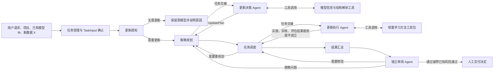

# 架构基线

本文记录当前已讨论清楚的设计意图。它是后续实现的约束，不把示意图中的每个方框解释成预制的一键更新器。图中的 LangGraph、A2A 和 MCP 是原架构标注，不等于已经选定的全部技术依赖。第一版人工编排原型采用 Pi 作为 Harness，但不形成永久技术锁定，具体决定见 [`design-docs/decisions/0001-pi-prototype-harness.md`](design-docs/decisions/0001-pi-prototype-harness.md)。

## 主流程



更新感知模块负责判断是否进入更新流程；其判据目前没有定稿，不能先假设成某个固定阈值或规则。第一版最小闭环不实现自动更新感知，由人类明确创建需要更新的任务并从策略规划开始。主控流程负责状态、分支、重规划和结果汇总，不代替 Agent 做方法选择或项目代码改造。

## 任务受理

第一版不增加单独的“任务理解 Agent”。更新决策 Agent 在策略规划前先执行任务受理：保留用户原始 Prompt，把目标、项目位置、原模型定位方式、新数据用途、保留能力和业务成功期望整理为最小 `TaskInput` 草案。最小字段缺失时提出固定必答问题，其他补充问题保持可跳过，并等待人类确认。

任务确认后，决策 Agent 才调用模型结构、数据分析等只读工具生成证据。模型结构、数据分布、训练入口和方法选择结论不属于用户初始输入，也不得为了补齐 `TaskInput` 而猜测。详细规则见 [`product-specs/task-intake.md`](product-specs/task-intake.md)。

## 模型项目理解与结构解析前置流程

`TaskInput` 通过 `confirmed` 校验后，更新决策 Agent 才能进入模型项目理解阶段。该阶段使用 [`../skills/model-project-understanding/SKILL.md`](../skills/model-project-understanding/SKILL.md) 对目标项目进行只读、证据化调查，终点是形成一个或多个模型候选和模型创建方案，不创建模型实例。

```text
TaskInput confirmed
        ↓
资产入口快速复核
        ↓
项目理解 Agent
        ├─ 人类声明了配置时调用 Config Inspector
        ├─ 按需调用 Checkpoint Inspector
        ↓ 综合源码与声明资产证据，形成模型候选、创建方案、未解决项
静态验证工具
        ↓ 已验证的创建方案
本地 worker：实例化、权重加载、结构解析
        ↓ 实例化报告 + 模型结构事实
更新决策 Agent
```

任务受理在请求人工确认前先对目标项目、明确提供的 checkpoint、可选模型配置文件和新数据位置执行只读资产预检；确认校验通过后、进入项目理解前再次快速复核。预检只回答路径是否存在、类型是否符合约定以及当前是否可读，不分析路径内的项目、配置、模型或数据。结果保存在独立 `AssetPreflightReport` 中，通过任务、版本和资产声明摘要绑定 `TaskInput`，不写回业务输入。

项目理解 Agent 可以定位构造入口、创建调用位置、实例提取路径、构造参数来源、创建后生命周期操作和 checkpoint 绑定，但不得导入或执行目标项目代码。人类明确提供模型配置时，Agent 通过安全 Config Inspector 读取；未提供时不得自动搜索配置。Checkpoint Inspector 可以按需提供只读结构证据。两个报告都只用于形成 proposal，不替代静态验证或实际加载。旧工具使用的 `model_definition_site`、`model_instantiation_site` 和 `model_instance_path` 可以出现在人类调查报告中，但不再作为机器创建契约；它们也不是用户或 `TaskInput` 必填字段。

项目理解 Agent 还应从调查结果中整理一个或多个只包含实例创建必要字段的 `ModelCreationProposal`。每个 proposal 用有序 `construction_steps` 和对象引用表达基础模型、外层包装、运行时对象、目标模型、生命周期操作接收对象及 checkpoint 加载目标。静态验证工具不重新理解整个项目，也不验证整份自然语言调查报告；它只定向检查这条完整对象创建链的 callable、参数、步骤依赖、结果路径、必要生命周期操作、源码锚点和 checkpoint 加载指令。静态验证器不打开 checkpoint；结构证据由上游专用 Inspector 提供，实际加载由本地实例化工具尝试完成。详细契约见 [`product-specs/model-creation-validation.md`](product-specs/model-creation-validation.md)。

声明资产检查器的输入绑定、安全格式和证据使用规则见 [`product-specs/model-asset-evidence-inspection.md`](product-specs/model-asset-evidence-inspection.md)。

实例化工具在重新核验方案后，于本地 Python 子进程实际导入、调用和尝试加载权重；当前模式没有操作系统级隔离，不能保证目标项目只读、网络被阻断或子进程副作用完全受控。需要结构事实时，`analyze_validated_model_structure` 在同一 worker 内创建模型并直接分析内存对象，不应先调用独立的实例化工具再为结构解析重复创建。第一版结构解析只读取注册模块、参数和缓冲区，不执行 `forward()`。Agent 不得通过临时编写执行代码绕过这些工具。存在多个都能通过静态验证但尚未由上游选择的 proposal 时，不得按源码顺序默认选择第一个，应保留歧义并交由更新决策 Agent 或人类处理。

## Harness 与流程编排

这里的 **harness** 指承载 Agent 工作的运行环境：连接模型和工具，管理会话上下文、任务指令、代码工作区、工具调用与结果记录。它尤其关系到执行 Agent 能否持续理解并修改陌生项目。第一版使用 Pi 验证闭环；业务契约与 Pi 私有格式解耦，原型完成后仍可重新评估或替换 Harness。

采用 Pi 原型时，必须按 [`references/pi-agent-loop.md`](references/pi-agent-loop.md) 理解运行过程：一次用户任务可以在模型、Tool Call、Tool Result 之间经历多轮循环；Agent 停止请求工具只表示本轮运行结束，不能替代训练和交付验收。CLI 用于学习与人工原型，正式自动化可评估使用 Pi SDK 创建受控的 AgentSession 并接入项目编排层。

LangGraph 属于流程编排技术，与 harness 并非同一层概念，也不是必须二选一。第一版先验证决策、交接、代码改造和反馈能否闭环；主控流程可以从简单实现开始。只有出现明确的复杂分支、持久化恢复或人工介入需求时，再评估是否需要 LangGraph 等专门编排框架。

A2A 适用于独立 Agent 服务之间的通信；若三个角色在同一应用内由不同会话承担，先用清晰的任务契约和结果契约交接即可。MCP 是一种工具接入方式；使用 Pi 时需另行实现或安装相应扩展。协议选择不改变下文的职责边界。

## 三个 Agent 的分工

| 环节 | 更新决策 Agent | 更新执行 Agent | 独立审阅 Agent |
| --- | --- | --- | --- |
| 核心问题 | 用什么方法，为什么用，须满足什么约束？ | 在这个项目里如何实现该方法？ | 实际执行和交付证据是否可信且满足验收？ |
| 输入 | 已确认的 `TaskInput`；随后通过只读工具获得模型与数据分析证据 | 已批准的 `UpdatePlan`、项目代码及必要数据和模型资料 | 任务、计划、实际代码、运行记录、权重、指标和模型档案 |
| 可以做 | 调用分析工具；权衡方法、前提与目标；形成计划 | 自行阅读代码；定位数据、训练入口和 loss；调用方法工具；修改代码；实际训练与评估；核对结果 | 只读核对原始证据；运行受控的非破坏性复验；形成独立结论 |
| 不应做 | 预先指定具体文件、行号或项目级代码改法 | 忽略计划前提，或在前提不成立时强行套用方法 | 修改实现或结果；仅依据执行 Agent 总结通过；自行放宽验收标准 |
| 输出 | 面向执行 Agent 的 `UpdatePlan` | 代码改动、新模型权重、评估结果、运行记录及问题反馈 | `ReviewResult`、问题清单和交付建议 |

决策 Agent 可以知道“EWC 需要旧任务信息、Fisher 信息及正则化强度”等方法前提，但无需找出当前项目的 `loss` 所在文件。执行 Agent 才负责核对这些前提是否具备，并决定如何把 EWC 项加入实际训练流程。可能还需要处理旧参数快照、Fisher 估计与状态保存，因此实现范围不能事先简化为一行代码。

## 工具的职责

**策略规划工具包**提供可复用的事实或分析能力，例如读取模型基本资料、解析模型结构。它给决策 Agent 提供证据，不替它选择业务策略。

**增量学习工具包**提供方法层面的知识和可调用能力，例如 EWC 的算法约束、所需状态、计算组件或校验能力。具体调用形式需要在实现时定义，可通过 MCP 或直接工具接口接入 harness。它不假定任意项目都有相同的训练入口、数据接口或损失函数位置；执行 Agent 负责项目适配。

首个已实现方法包是 `incremental_ridge_closed_form` v0.1：方法卡固定平方误差总和加 L2 正则及其硬前提，Python 组件负责检查充分统计量并执行有界解析更新，Pi 工具只提供状态检查与内联小矩阵更新。它不自动定位项目对象、读取任意数据路径、修改代码或保存 checkpoint。该实现验证的是“方法知识 + 确定性组件”的边界，不预先决定后续 EWC、Replay 或结构扩展方法的封装形式。

图中“线性回归、MLP、CNN、Transformer 更新工具”应视为待重新界定的示例能力，不能直接实现成按模型类型选择的一键改造规则。

## 交接契约与任务状态

第一版定义 `TaskInput`、`UpdatePlan`、`ExecutionResult` 和 `ReviewResult` 四类逻辑契约。计划应让执行 Agent 理解：更新目标和保留目标、选择的方法及理由、方法成立的前提、必须遵守的约束、期望的交付物，以及需要核实的不确定点。

计划不包含未核实的代码路径、修改行号或“直接在某处加正则项”这类项目级指令。执行 Agent 对实际代码负责，发现方法前提不成立时返回证据，触发重规划。

最小状态流、人工批准节点和契约字段以 [`product-specs/minimal-model-update-agent.md`](product-specs/minimal-model-update-agent.md) 为准。具体序列化格式将在实现阶段确定。

## 交付状态

执行 Agent 必须实际运行训练和评估，并说明修改了什么、依据是什么、运行过哪些验证以及仍有哪些限制。只有生成可加载的新权重，并形成原模型与新模型的效果对比、训练记录和对应模型描述档案后，才可以称为“已更新模型”。仅完成代码修改不构成最终交付。

## 尚待确定

- 更新感知如何判断需要更新，以及无法判断时如何处理。
- 四类逻辑契约的具体序列化与存储接口；工具是否采用 A2A、MCP 或其他接入方式。
- Pi 原型之后是否继续采用 Pi SDK，以及是否需要专门流程编排框架。
- 执行 Agent 的代码修改边界、训练资源管理与失败回退方式。
- 更新效果的验收指标、模型档案字段及最终交付方式。
